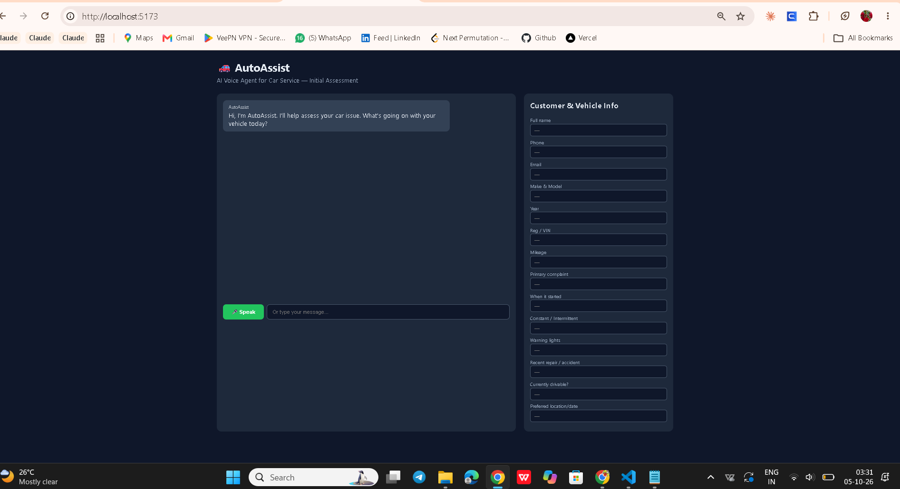
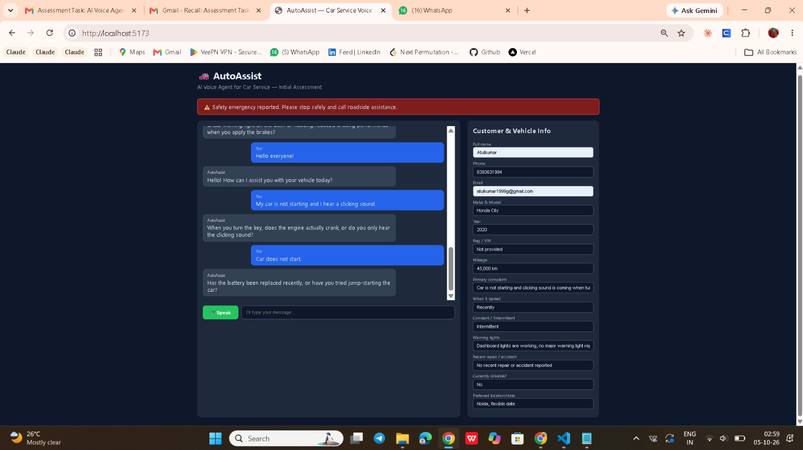
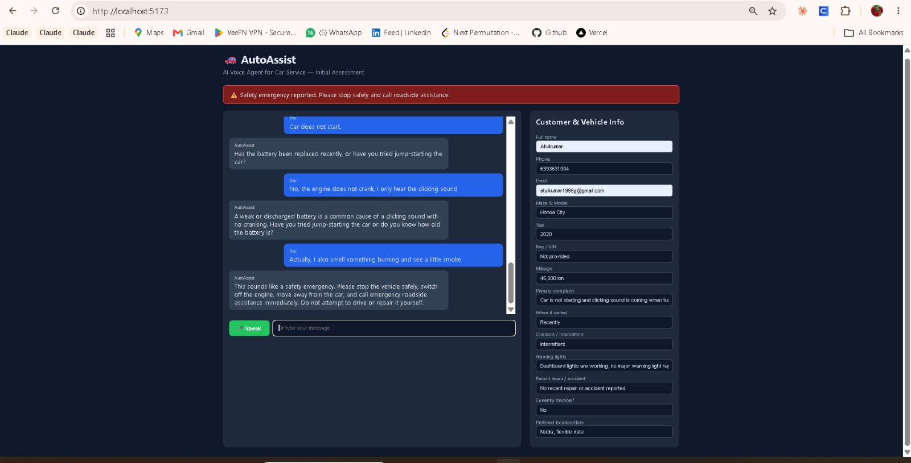
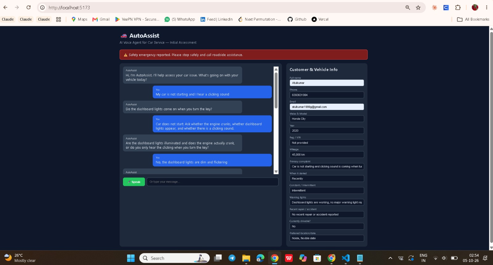
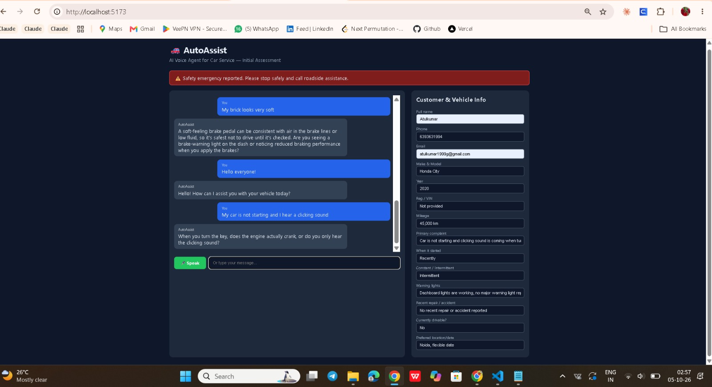
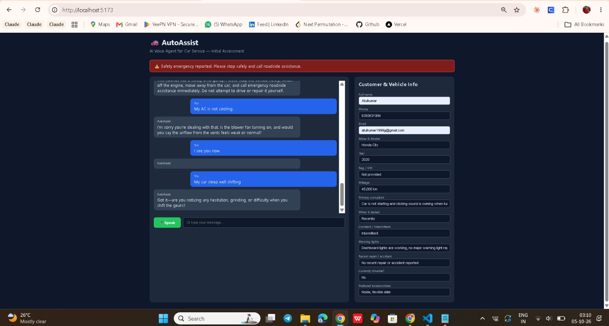

# 🚗 AutoAssist — AI Voice Agent for Car Service

An AI voice agent that performs an initial customer assessment for a car service provider. It uses RAG over a curated knowledge base, follows strict safety rules, and never gives a definitive diagnosis.

## ✨ Features
- 🎙️ Voice input (Whisper STT) + voice output (OpenAI TTS)
- 🧠 RAG over the car-service knowledge base (FAISS + OpenAI embeddings)
- ⚠️ Emergency detection (fire/smoke/brake/steering) short-circuits to safety advice
- 📋 Live customer & vehicle info collection panel
- 🛡️ Never claims a confirmed diagnosis; always recommends inspection
- 🎨 Clean dark UI with transcript + assessment sidebar

## 🏗️ Architecture
```
React (Vite)  ──HTTP──▶  FastAPI  ──▶  RAG (FAISS) + GPT-4o-mini
                             │
                             ├─▶ Whisper (STT)
                             └─▶ TTS (OpenAI)
```
---

## 📸 Screenshots

### 🏠 Home — Initial UI


### 💬 Conversation — Agent in Action


### ⚠️ Emergency Detection — Safety Banner


### 🧪 Test 1 — Agent Response (Starting Issue)


### 🧪 Test 2 — Follow-up Conversation


### 🎤 Voice Test — Speech-to-Text in Action


### 📋 Customer Info Auto-Collection


### 📖 Backend API Docs

## 🚀 Local Setup

### Backend
```bash
cd backend
python -m venv venv && source venv/bin/activate   # Windows: venv\Scripts\activate
pip install -r requirements.txt
cp .env.example .env    # then add your OPENAI_API_KEY
uvicorn app.main:app --reload --port 8000
```

### Frontend
```bash
cd frontend
npm install
cp .env.example .env    # set VITE_API_URL=http://localhost:8000
npm run dev
```
Open http://localhost:5173

### Docker
```bash
docker-compose up --build
```

## 🔑 Environment Variables

### Backend (`backend/.env`)
| Key | Description |
|-----|-------------|
| `OPENAI_API_KEY` | Your OpenAI API key (required) |
| `OPENAI_MODEL` | Chat model (default `gpt-4o-mini`) |
| `OPENAI_TTS_MODEL` | TTS model (default `tts-1`) |
| `OPENAI_TTS_VOICE` | Voice (default `alloy`) |
| `OPENAI_STT_MODEL` | STT model (default `whisper-1`) |
| `ALLOWED_ORIGINS` | Comma-separated CORS origins |

### Frontend (`frontend/.env`)
| Key | Description |
|-----|-------------|
| `VITE_API_URL` | Backend base URL |

## 🌐 Deployment

**Backend → Render / Railway / Fly.io**
- Build: `pip install -r requirements.txt`
- Start: `uvicorn app.main:app --host 0.0.0.0 --port $PORT`
- Set env vars from above.

**Frontend → Vercel / Netlify**
- Build: `npm run build`
- Output: `dist`
- Set `VITE_API_URL` to your deployed backend URL.

## 🛡️ Safety Design
- **Emergency classifier** runs before LLM: keywords like *fire, smoke, fuel leak, brake failed, steering failed* → immediate safety response.
- **System prompt** forbids definitive diagnosis and dangerous repair advice.
- **RAG grounding** ensures answers come only from the curated knowledge base.
- **One-question-at-a-time** flow for voice usability.

## 📁 Project Layout
See folder tree in repo root.

# 🚗 AutoAssist — AI Voice Agent for Car Service Provider

> An AI-powered voice agent that performs **initial customer assessment** for a car service provider. Uses Retrieval-Augmented Generation (RAG) over a curated knowledge base, follows strict safety rules, and never presents a diagnosis as certain.


---

## 📑 Table of Contents

- [Overview](#-overview)
- [Key Features](#-key-features)
- [Architecture](#-architecture)
- [Tech Stack](#-tech-stack)
- [Project Structure](#-project-structure)
- [Quick Start](#-quick-start)
- [Environment Variables](#-environment-variables)
- [API Reference](#-api-reference)
- [RAG Implementation](#-rag-implementation)
- [Safety & Escalation](#-safety--escalation)
- [Agent Behavior Rules](#-agent-behavior-rules)
- [Testing](#-testing)
- [Deployment](#-deployment)
- [Evaluation Coverage](#-evaluation-coverage)
- [Troubleshooting](#-troubleshooting)
- [License](#-license)

---

## 🎯 Overview

**AutoAssist** is a production-ready AI voice agent that handles the **first point of contact** for a car service provider. Instead of a human receptionist asking basic questions, the agent:

- 🎙️ Listens to the customer's car issue via **voice** (or text)
- 🧠 Retrieves relevant guidance from a **12-section knowledge base**
- 📋 Collects customer & vehicle information **progressively**
- ⚠️ Detects **safety emergencies** and escalates immediately
- 🛡️ **Never diagnoses** — always recommends professional inspection
- 🔊 Responds in **natural voice** for a conversational experience

**Built for:** Full Stack Developer Assignment  
**Status:** ✅ End-to-end working (backend + frontend + voice tested)

---

## ✨ Key Features

### 🎙️ Voice-First Interface
- **Speech-to-Text:** Groq Whisper Large v3 (free, fast, accurate)
- **Text-to-Speech:** Browser Web Speech API (no API key, instant)
- **Text fallback:** Type messages if voice is unavailable

### 🧠 Intelligent RAG
- **12-section knowledge base** covering engine, battery, brakes, AC, transmission, and more
- **Keyword-overlap retrieval** — top 4 relevant sections injected into LLM context
- **Zero external embedding cost** — deterministic, fast (<5ms)

### ⚠️ Safety-First Design
- **Programmatic emergency classifier** runs *before* LLM call
- **12 emergency triggers** — fire, smoke, fuel leak, brake failure, etc.
- **Red banner** on frontend + immediate safety advice
- **Never** advises dangerous DIY repairs

### 📋 Live Info Collection
- **14-field sidebar** auto-syncs as conversation progresses
- Fields: name, phone, email, make/model, year, VIN, mileage, complaint, etc.
- Backend receives collected info for follow-up context

### 🎨 Professional UI
- **Dark theme** with high contrast
- **Chat bubbles** (user blue, agent grey)
- **Emergency banner** (red, prominent)
- **Mic button** with recording animation
- **Responsive** layout (mobile-friendly)

---

## 🏗️ Architecture
┌─────────────────────────────────────────────────────────────┐
│ 👤 USER (Browser) │
│ 🎤 Voice Input │ ⌨️ Text Input │ 📋 Info Sidebar │
└────────────────────────┬────────────────────────────────────┘
│ HTTP / JSON
▼
┌─────────────────────────────────────────────────────────────┐
│ 🎨 FRONTEND (React + Vite) │
│ │
│ VoiceAgent.jsx → Main chat orchestration │
│ AssessmentCard.jsx → 14-field customer info panel │
│ Transcript.jsx → Chat bubble rendering │
│ useVoice.js → MediaRecorder + Web Speech API │
└────────────────────────┬────────────────────────────────────┘
│ REST API
▼
┌─────────────────────────────────────────────────────────────┐
│ ⚙️ BACKEND (FastAPI) │
│ │
│ POST /chat ──▶ agent.py │
│ ├─ Emergency classifier (regex) │
│ ├─ RAG retrieval call │
│ ├─ System prompt + context │
│ └─ Groq LLM (Llama 3.3 70B) │
│ │
│ POST /stt ──▶ voice.py │
│ └─ Groq Whisper Large v3 │
│ │
│ GET /health ──▶ Health check │
│ │
│ rag.py ──▶ Keyword retrieval from knowledge_base.md │
│ config.py ──▶ Environment variables │
│ models.py ──▶ Pydantic schemas │
└────────────────────────┬────────────────────────────────────┘
│
▼
┌─────────────────────────────────────────────────────────────┐
│ 📚 knowledge_base.md (12 sections) │
│ 1. Engine/Starting 7. Transmission │
│ 2. Battery/Elec. 8. Air Conditioning │
│ 3. Overheating 9. Unusual Noise/Smell │
│ 4. Brakes 10. Customer Info to Collect │
│ 5. Tyres/Steering 11. Safety/Escalation Rules │
│ 6. Engine Light 12. Example Assessment │
└─────────────────────────────────────────────────────────────┘

text

---

## 🛠️ Tech Stack

| Layer | Technology | Why |
|---|---|---|
| **Frontend** | React 18 + Vite 5 | Fast HMR, modern DX |
| **Styling** | Custom CSS | No framework overhead |
| **Voice (STT)** | Groq Whisper Large v3 | Free, fast, accurate |
| **Voice (TTS)** | Browser Web Speech API | Zero cost, instant |
| **Backend** | FastAPI + Uvicorn | Async, auto-docs, fast |
| **LLM** | Groq `openai/gpt-oss-120b` | Free tier, Llama 3.3 70B class |
| **RAG** | Custom keyword retrieval | No embedding cost |
| **Validation** | Pydantic v2 | Type-safe schemas |

---

## 📁 Project Structure
car-service-voice-agent/
│
├── backend/
│ ├── app/
│ │ ├── init.py # Package metadata
│ │ ├── main.py # FastAPI app + routes
│ │ ├── config.py # Env settings
│ │ ├── agent.py # LLM agent + safety
│ │ ├── rag.py # Knowledge retrieval
│ │ ├── voice.py # Groq Whisper STT
│ │ ├── models.py # Pydantic schemas
│ │ └── knowledge_base.md # 12-section KB
│ ├── requirements.txt
│ ├── .env.example
│ └── Dockerfile
│
├── frontend/
│ ├── src/
│ │ ├── App.jsx
│ │ ├── main.jsx
│ │ ├── styles.css
│ │ ├── components/
│ │ │ ├── VoiceAgent.jsx # Main UI
│ │ │ ├── Transcript.jsx # Chat bubbles
│ │ │ └── AssessmentCard.jsx # 14-field sidebar
│ │ └── hooks/
│ │ └── useVoice.js # Mic + TTS logic
│ ├── index.html
│ ├── package.json
│ ├── vite.config.js
│ └── .env.example
│
├── README.md
├── .gitignore
└── docker-compose.yml

text

---

## 🚀 Quick Start

### Prerequisites

| Requirement | Version | Notes |
|---|---|---|
| Python | 3.11+ | For backend |
| Node.js | 20+ | For frontend |
| Groq API Key | Free | [Get one here](https://console.groq.com/keys) |
| Browser | Chrome / Edge | For voice input (MediaRecorder) |

### 1️⃣ Backend Setup

```bash
cd backend

# Create virtual environment
python -m venv venv
venv\Scripts\activate          # Windows
# source venv/bin/activate     # Mac / Linux

# Install dependencies
pip install -r requirements.txt

# Configure environment
copy .env.example .env         # Windows
# cp .env.example .env         # Mac / Linux
notepad .env                   # Add your GROQ_API_KEY

# Run server
uvicorn app.main:app --reload --port 8000
✅ Backend live at: http://localhost:8000
📖 API docs: http://localhost:8000/docs

2️⃣ Frontend Setup
bash
# Open a NEW terminal
cd frontend

# Install dependencies
npm install

# Configure environment
copy .env.example .env         # Windows
# cp .env.example .env         # Mac / Linux

# Start dev server
npm run dev
✅ Frontend live at: http://localhost:5173

3️⃣ Test It
Open http://localhost:5173 and try:

Type: My car is not starting and I hear a clicking sound

Voice: Click 🎤 Speak, say the same

Emergency: Type My car is on fire → red banner appears

Trigger Flow
User message → Emergency classifier
                     │
              ┌──────┴──────┐
              │             │
           MATCH         NO MATCH
              │             │
              ▼             ▼
     Safety response    RAG + LLM
     (bypass LLM)       (normal flow)
              │             │
              ▼             ▼
      emergency:true    emergency:false
              │             │
              └──────┬──────┘
                     ▼
              Frontend UI
              (red banner if true)
              🧪 Testing
Test Suite
#	Input	Expected Output
1	My car is not starting and I hear a clicking sound	Ask about dashboard lights / engine cranking
2	No, the engine does not crank, I only hear clicking	"Weak or discharged battery..." + follow-up
3	My brake pedal feels very soft	"Can be consistent with air in brake lines..."
4	My car is on fire	🔴 Emergency banner + safety advice
5	I smell something burning and see a little smoke	🔴 Emergency banner + safety advice
6	My name is Atul, my phone is 6393631994	Sidebar auto-fills name + phone
7	My AC is not cooling and there's a weird smell	Ask about blower, airflow, engine speed
8	My check engine light is flashing	"Treat as urgent, avoid continued driving"
9	My steering wheel shakes at high speed	Ask about braking/acceleration/turning
10	My car slips when shifting from Park to Drive	Ask about specific gears + recommend inspection